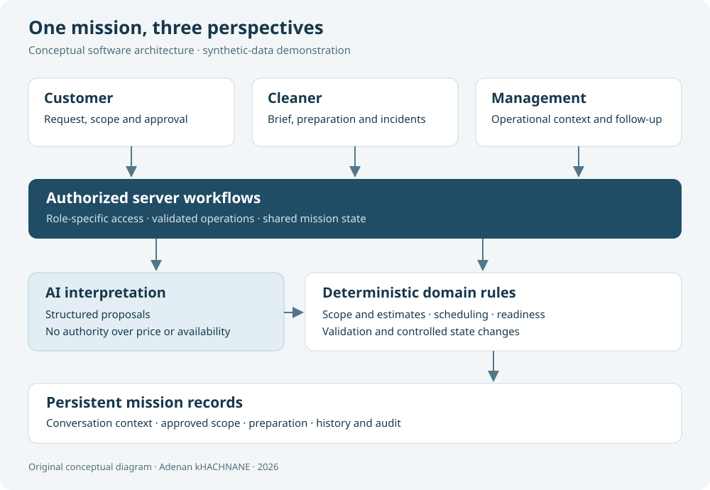
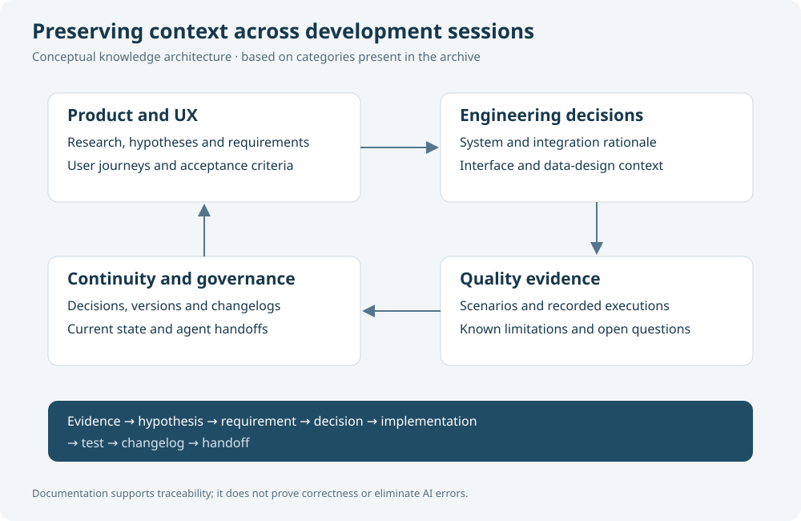

# Architecture overview

Two architectures support this project: **the software architecture coordinates a mission at runtime; the knowledge architecture helps development preserve the reasons and evidence behind it.** They are shown separately below.

## Software architecture



*Conceptual view of the inspected implementation. The diagram omits private data models, security configuration and orchestration details. [PNG alternative](assets/diagrams/software-architecture.png).*

### Presentation and access

Customer, cleaner and management interfaces share relevant components while exposing different information and actions. The customer composes a request; the cleaner sees an operational brief rather than the quote; management sees preparation and incident context. Management is currently a desktop-oriented interface.

Next.js and React provide these surfaces. Authorization is enforced by server-side application boundaries, rather than relying on the menu to hide an action. A common mission record reduces the need to reconstruct the same scope separately for each role.

### AI interpretation and deterministic rules

The AI integration uses DeepSeek through a server-side provider. It proposes structured operations, which are validated before business state changes. The model is not the authoritative source for catalog availability, prices, equipment compatibility or appointments.

Deterministic domain services govern estimates, task plans and scheduling constraints. TypeScript and validation schemas help keep the interface between interpretation and business rules explicit. Validation can reject an unsupported structure; it cannot prove that a semantically valid proposal faithfully understood every customer intention.

The alternative—treating natural-language output as an authoritative business result—would blur explanation and execution. Separating them allows pricing and state rules to be reviewed independently. AI still introduces latency, variable output quality and a need for bounded recovery and clear error states.

### Persistence and continuity

Neon PostgreSQL stores the conversation, selected scope and mission records. Drizzle supports data access and transactional operations. Approval and version history are retained so that a mission’s operational brief refers to an agreed scope rather than whatever happens to be displayed in one browser.

Booking and assignment need a shared decision about availability. Transactions and server-side revalidation address concurrent changes and interrupted responses. The private implementation contains the detailed constraints; this showcase describes their purpose rather than distributing the schema or algorithms.

Preparation records are associated with the relevant mission and cleaner context. An incident resolution is a recorded decision, not automatic proof that the physical equipment is ready. Full replacement handovers, independent rechecks and later approved changes remain broader work than the current demo establishes.

### Deployment and practical trade-offs

Vercel hosts the application and Neon provides persistence; the application is a modular monolith rather than separately operated microservices. This keeps UI and server workflows in one deployment while preserving domain boundaries. The trade-off is that remote AI calls, shared quotas, background work and hosting limits must be handled deliberately.

Historical records show a successful production build and deployment on 12 November. The public root page was reachable during this review. That verifies access to the entry point, not every authenticated workflow or the health of every background process.

The demo’s people, availability, prices and records are synthetic. No connection to the company’s official applications, payment processor, real stock system or external cleaner calendar is claimed.

## Engineering Documentation & AI Development Workflow

### Documentation structure

The tree below reflects the **actual main folders and selected subfolders** in the original project documentation. Descriptions are summarized for this public showcase; the private documents and their contents are not included.

```text
doc/
├── INDEX.md and PROJECT_STATE.md   Entry points and current state
├── CHANGELOG.md                   Changes and dated references
├── product/                       Product requirements and scope
├── design/                        UX journeys and design system
│   ├── evidence/                  Visual research and supporting material
│   └── resources/                 Design resource provenance
├── features/                      Domain and feature documentation
├── architecture/                  System design and component boundaries
├── database/                      Data model documentation
├── decisions/                     Decision registry and ADRs
├── testing/                       Acceptance criteria and validation
│   └── evidence/                  Recorded test and review evidence
├── operations/                    Environments and operating guidance
├── sessions/                      Dated work sessions and agent handoffs
└── reference/                     Preserved source and design references
    ├── originals/                 Read-only historical source snapshot
    ├── corrections-2026-11-10/    Product and UX corrections
    ├── trigger-catalog/           Conversation catalog references
    ├── legacy/                    Earlier working documents
    └── back-office/               Design documentation and prototypes
```

The source also has other top-level overview documents; the selected files above orient readers toward the index, current state and change history.

### How the knowledge is used



*A conceptual view of how those documentation categories support continuity. [PNG alternative](assets/diagrams/knowledge-workflow.png).*

The archive contains product requirements and UX journeys, system and integration documentation, test scenarios and evidence, decisions, changelogs and dated session handoffs. An index and current-state summary orient the next agent; retained historical versions reveal superseded choices.

The supported traceability pattern is **evidence → hypothesis → requirement → decision → implementation → test → changelog → handoff**. Individual links vary in strength; a recorded decision is not proof that a feature works. Source-preservation and link checks protect continuity, while session notes record validation limits and unfinished work.

This structure can reduce repeated decisions and context loss during AI-assisted engineering. It does not make the process fully reproducible or eliminate unsupported assumptions.

## Technology and evidence boundary

Inspected application files support the use of Next.js, React, TypeScript, Neon PostgreSQL, Drizzle, validation schemas and reusable UI components. The private project also contains unit and browser test tooling. Historical runs establish selected behavior; this review did not rerun the application test suites.

Known work remains around legacy tests, accessibility, physical-device voice input, account recovery, production security and validation of operational policies. These are prototype boundaries, not hidden claims of production readiness.

[Product status](PRODUCT_OVERVIEW.md) · [Back to README](README.md)
