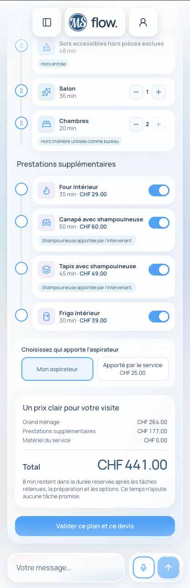

# MénageSimple Flow

### From a cleaning request to a coordinated mission

A customer’s instructions are only useful if the cleaner can act on them and management can follow what happens next. **MénageSimple Flow explores that continuity through one structured mission shared across three roles.**

Created by **Adenan kHACHNANE** as an independent recruitment exercise. It is not affiliated with or officially endorsed by MénageSimple or Stonks Holding AG.

**[Explore the public demo](https://menagesimple-flow.vercel.app/)** · **[Read the case study](CASE_STUDY.md)** · **[Research and discovery](RESEARCH_AND_DISCOVERY.md)**

> This is a software demonstration with synthetic people, availability, prices and operational records. It is not a live cleaning service. Please use fictional information only. Private-role access is not distributed in this repository.

## The product in three views

| Customer | Cleaner | Management |
|---|---|---|
| Explain a need, clarify what is missing, review scope and a calculated quote, then select a demo appointment. | Receive the mission brief, review instructions and equipment, respond to the request and report an issue. | See mission states, preparation and incidents; inspect the operational context through a desktop workspace. |

The starting point was **research into the service and its public-facing experience**, followed by hypotheses about expectations, equipment and continuity. Flow is a design response to those hypotheses, not evidence of confirmed failures within the company.

## A real implementation artifact

*Application screenshots supplied and approved by the project owner. The product UI is in French; these showcase documents are in English. The displayed request and prices are from the synthetic demonstration.*

## What was built—and what remains exploratory

- **Implemented in the demo:** conversational qualification, contextual controls, deterministic quotes, synthetic scheduling, accounts, mission views and an authenticated management workspace.
- **Tested on selected scenarios:** calculation and access rules, mission persistence and specific AI interpretation cases. Historical execution records support those claims; the latest revision has not had a complete end-to-end retest.
- **Designed or simulated:** property memory, full recurring-service workflows, urgent dispatch, complete replacement handovers and aftercare/time-dispute handling.

No field study demonstrates cost savings, adoption or service-quality improvements. Some legacy tests remain unresolved. **[Capability status and boundaries](PRODUCT_OVERVIEW.md)**

## Engineering approach

Next.js and React provide the interfaces; TypeScript and server-side validation connect AI proposals to deterministic domain rules. Neon PostgreSQL persists the records, and Vercel hosts the demo. AI interprets language; it does not determine authoritative prices or availability.

The project also has a knowledge architecture: a concise tree of the original documentation folders shows how product evidence, decisions, tests and session handoffs help AI-assisted development resume without treating an old proposal as the current implementation. **[Engineering Documentation & AI Development Workflow](ARCHITECTURE_OVERVIEW.md#engineering-documentation--ai-development-workflow)**

## Read the story

| Document | What it explains |
|---|---|
| [Case study](CASE_STUDY.md) | Research, hypotheses, product pivots, engineering and validation. |
| [Research and discovery](RESEARCH_AND_DISCOVERY.md) | Public evidence, review limitations and the questions still open. |
| [Product overview](PRODUCT_OVERVIEW.md) | The coordinated mission lifecycle and the status of each capability. |
| [Design decisions](DESIGN_DECISIONS.md) | Why the conversation, scope controls and readiness checks take their current form. |
| [Architecture overview](ARCHITECTURE_OVERVIEW.md) | Software boundaries and the documentation workflow behind the project. |

This repository is a curated case study, not the application source or its private knowledge base. Original showcase materials are **© 2026 Adenan kHACHNANE. All rights reserved**; see [LICENSE](LICENSE). Third-party elements retain their own rights and [notices](THIRD_PARTY_NOTICES.md).
