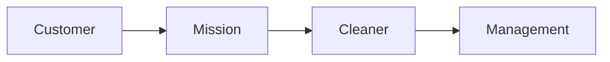
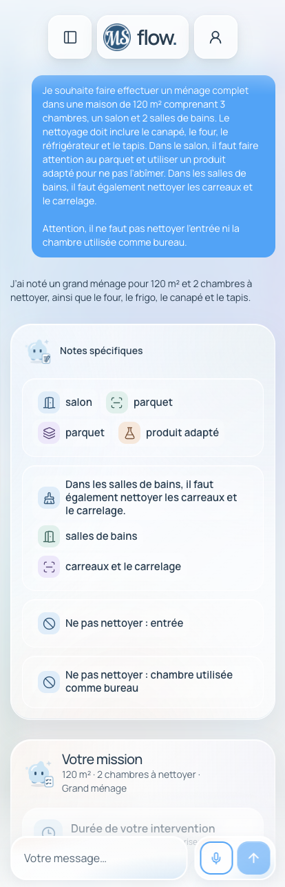
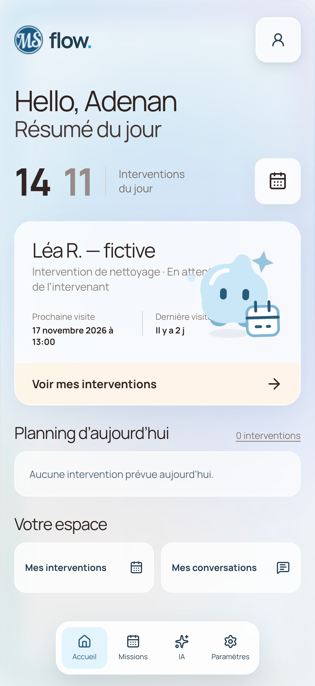
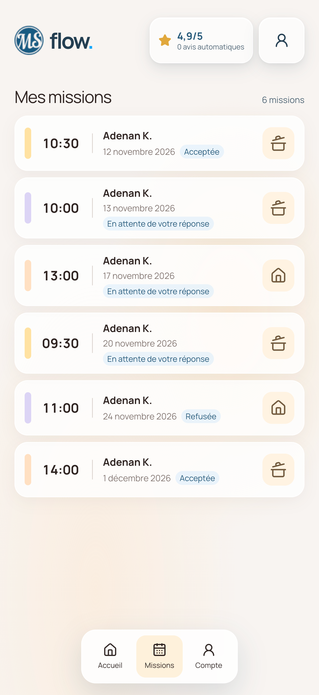
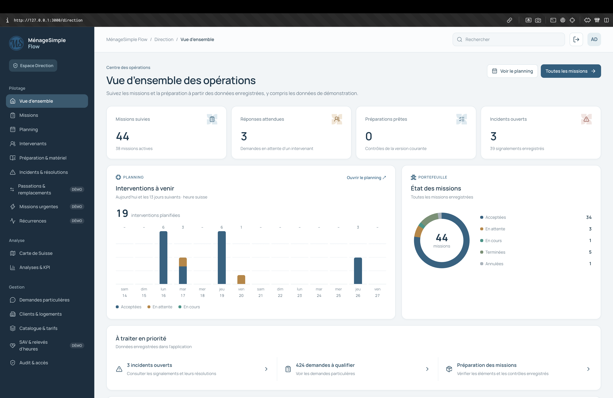
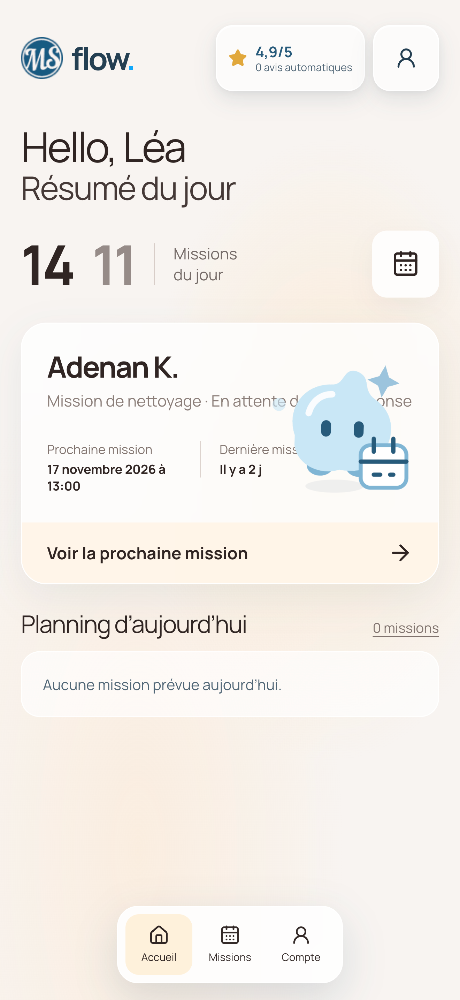
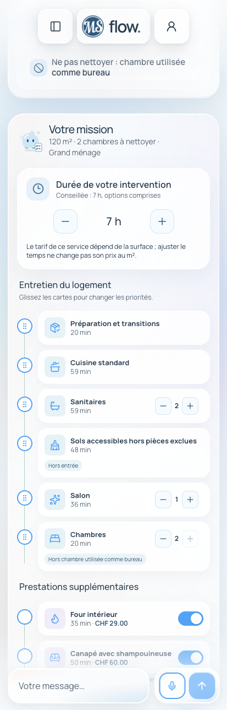

# MénageSimple Flow

### From a cleaning request to a coordinated mission

A customer’s instructions are only useful if the cleaner can act on them and management can follow what happens next. **MénageSimple Flow explores that continuity through one structured mission shared across three roles.**

Created by **Adenan kHACHNANE** as an independent recruitment exercise. It is not affiliated with or officially endorsed by MénageSimple or Stonks Holding AG.

**[Explore the public demo](https://menagesimple-flow.vercel.app/)** · **[Read the case study](CASE_STUDY.md)** · **[Research and discovery](RESEARCH_AND_DISCOVERY.md)**

> This is a software demonstration with synthetic people, availability, prices and operational records. It is not a live cleaning service. Please use fictional information only. Private-role access is not distributed in this repository.

## From request to coordinated mission

One shared mission carries the scope from the customer’s request to the cleaner’s brief and management’s operational view.

*Customer conversation and specific notes. The request is synthetic; the application interface is in French.*

## Three interfaces, one shared mission

<table>
  <tr><th>Customer workspace</th><th>Cleaner workspace</th></tr>
  <tr>
    <td></td>
    <td></td>
  </tr>
  <tr><td>Follow visits and conversations.</td><td>Review assigned requests and their status.</td></tr>
</table>

**Management workspace**

*The screens are from the application using demo records. Names, ratings, prices, counts and incident data are illustrative, not evidence of real customers or business results.*

More application screens

## How to Evaluate

**Live demo:** [https://menagesimple-flow.vercel.app/](https://menagesimple-flow.vercel.app/)

MénageSimple Flow can be explored through three dedicated interfaces.

1. **Customer Experience** — Describe a cleaning request in natural language, including specific tasks, equipment requirements, and special instructions. Explore how the AI structures the request, asks contextual questions, and generates a detailed mission summary.
2. **Cleaner Experience** — Sign in with the cleaner demo account to review assigned missions, customer instructions, equipment requirements, and issue-reporting features.
3. **Management Experience** — Sign in with the administrator demo account to explore mission tracking, scheduling, incident management, and operational dashboards.

**What to look for:** How customer requirements are transformed into structured mission information and made available to the people responsible for executing and managing the service.

Demo credentials are provided separately to reviewers. Please use fictional information only.

This is an independent demonstration project using synthetic operational data, not a production integration with MénageSimple.

## Technical evidence

The following results are from recorded executions on **12 November 2026**; they are scoped evidence, not a current full-system certification.

| Area | Recorded result | Scope and limit |
|---|---|---|
| Production build | Local and Vercel builds passed; deployment reached Ready. | Build success does not verify every user journey. |
| AI pipeline and validation | 27 targeted tests passed. | Controlled tests cover selected extraction, pipeline and transport scenarios; they do not prove universal language understanding. |
| Live AI qualification | One complex request passed in a browser with the real provider; notes, service choices and reload were checked. | The test stopped before approving the quote or creating a mission. |
| Earlier complete application suite | 107 of 115 tests passed; eight legacy scenarios failed. | This run preceded the latest deployed revision and was not rerun in full for that release. |
| Historical reference engines | Two validators and 67 Python tests passed. | These validate the reference models and fixtures, not the deployed web application. |

The latest interface adjustments have not all received an end-to-end retest. No private test suites or customer data are published in this showcase.

## What was built—and what remains exploratory

- **Implemented in the demo:** conversational qualification, contextual controls, deterministic quotes, synthetic scheduling, accounts, mission views and an authenticated management workspace.
- **Tested on selected scenarios:** calculation and access rules, mission persistence and specific AI interpretation cases. Historical execution records support those claims; the latest revision has not had a complete end-to-end retest.
- **Designed or simulated:** property memory, full recurring-service workflows, urgent dispatch, complete replacement handovers and aftercare/time-dispute handling.

No field study demonstrates cost savings, adoption or service-quality improvements. Some legacy tests remain unresolved. **[Capability status and boundaries](PRODUCT_OVERVIEW.md)**

## Engineering approach

Next.js and React provide the interfaces; TypeScript and server-side validation connect AI proposals to deterministic domain rules. Neon PostgreSQL persists the records, and Vercel hosts the demo. AI interprets language; it does not determine authoritative prices or availability.

The project also has a knowledge architecture: a concise tree of the original documentation folders shows how product evidence, decisions, tests and session handoffs help AI-assisted development resume without treating an old proposal as the current implementation. **[Engineering Documentation & AI Development Workflow](ARCHITECTURE_OVERVIEW.md#engineering-documentation--ai-development-workflow)**

## Read the story

| Document | What it explains |
|---|---|
| [Case study](CASE_STUDY.md) | Research, hypotheses, product pivots, engineering and validation. |
| [Research and discovery](RESEARCH_AND_DISCOVERY.md) | Public evidence, review limitations and the questions still open. |
| [Product overview](PRODUCT_OVERVIEW.md) | The coordinated mission lifecycle and the status of each capability. |
| [Design decisions](DESIGN_DECISIONS.md) | Why the conversation, scope controls and readiness checks take their current form. |
| [Architecture overview](ARCHITECTURE_OVERVIEW.md) | Software boundaries and the documentation workflow behind the project. |

This repository is a curated case study, not the application source or its private knowledge base. Original showcase materials are **© 2026 Adenan kHACHNANE. All rights reserved**; see [LICENSE](LICENSE). Third-party elements retain their own rights and [notices](THIRD_PARTY_NOTICES.md).
